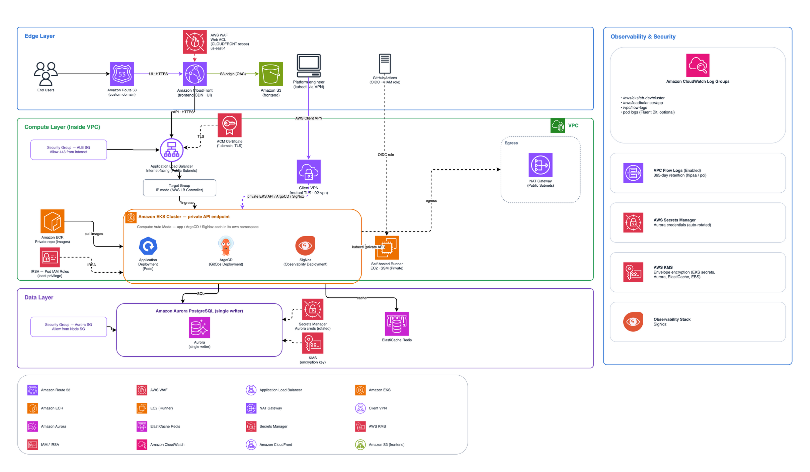

# ARC EKS Microservices Blueprint

[](https://www.terraform.io/)
[](https://aws.amazon.com/eks/)
[](https://kubernetes.io/)
[](https://github.com/sourcefuse)

A **production-ready, compliance-aware Terraform blueprint for deploying containerised microservices on Amazon EKS** — built exclusively on the [SourceFuse ARC](https://github.com/sourcefuse) module library. This blueprint is designed to be cloned, configured, and deployed by any team in minutes, then customised to fit their own application.

It includes three built-in compliance profiles (`general`, `hipaa`, `pci_dss`) so the same codebase can be used for development, healthcare (PHI), and payment-card workloads without changing Terraform.

---

## Table of Contents

- [Highlights](#highlights)
- [Architecture](#architecture)
  - [What is a Microservice?](#what-is-a-microservice)
- [Module Dependency Graph](#module-dependency-graph)
- [Repository Layout](#repository-layout)
- [Prerequisites](#prerequisites)
- [Quick Start — GitHub Actions](#quick-start--github-actions)
- [Quick Start — Local Terraform](#quick-start--local-terraform)
- [Compliance Profiles](#compliance-profiles)
- [AI Assistant Integration (ARC IaC MCP)](#ai-assistant-integration-arc-iac-mcp)
- [Contributing](#contributing)
- [License](#license)
- [Authors](#authors)

---

## Highlights

- **Isolated state per layer** — Each Terraform layer has its own state file, limiting blast radius and enabling parallel teams to own their slices.
- **Compliance profiles out of the box** — `general`, `hipaa`, and `pci_dss` tfvars shipped per layer; the CI/CD pipeline selects one at deploy time.
- **OIDC-based GitHub Actions** — No long-lived AWS access keys; jobs assume an IAM role via `AWS_ROLE_ARN`.
- **Private-only EKS API endpoint** — The Kubernetes API is never exposed publicly. An in-VPC **self-hosted GitHub Actions runner** runs every cluster-touching job so it can reach the private endpoint.
- **Operator access via Client VPN** — A mutual-TLS **AWS Client VPN** (`02-vpn`) lets engineers reach the private EKS API, internal ALBs, Aurora, and Redis from their workstations — without exposing anything to the internet.
- **Auto Mode or managed node groups** — Flip `enable_auto_mode` to choose AWS-managed compute (built-in Karpenter, ALB, EBS) or self-managed node groups plus add-ons.
- **GitOps + observability built in** — ArgoCD for pull-based delivery and SigNoz for metrics/traces, both deployed as layers.
- **Split UI / API delivery** — the frontend is served globally from CloudFront + S3; the backend API runs on EKS behind an ALB. Mirrors the ARC ECS blueprint.
- **Layered security** — CLOUDFRONT-scope WAF (managed rules + rate limiting) protecting the public UI edge, TLS at CloudFront and the ALB, KMS envelope encryption of Kubernetes secrets, encrypted Aurora and Redis, and Secrets Manager for credentials.

---

## Architecture

### What is a Microservice?

A **microservice** is a small, independently deployable unit of software that does one thing well. Instead of one large monolithic application, a microservices architecture breaks the system into focused services — each with its own codebase, deployment lifecycle, and scaling profile — that communicate over APIs.

**Benefits:**

- **Independent deployment** — Deploy and scale individual services without touching the rest of the system.
- **Fault isolation** — One service failing does not bring down the entire platform.
- **Technology flexibility** — Each service can choose the language, framework, and data store that best fits its domain.
- **Team ownership** — Small, focused teams can own end-to-end delivery of a service.
- **Elastic scaling** — Scale only the services under load, not the whole application.

> 💡 **In this blueprint:** every microservice runs as a Kubernetes Deployment on Amazon EKS behind an Application Load Balancer (provisioned by the AWS Load Balancer Controller from an Ingress). The container image is stored in ECR, the database is Aurora PostgreSQL, the cache is ElastiCache Redis, GitOps is handled by ArgoCD, observability by SigNoz — and the entire stack is defined in Terraform.

---



```
Internet
    │
    ▼
Route53 (A alias)
    │
    ▼
CloudFront ──── WAF (CLOUDFRONT scope, us-east-1)
    │
    ├──▶ S3 (OAC · static frontend)          — UI
    │
    └──▶ ALB (public subnets, HTTPS 443)     — API
              │
              ▼
         Amazon EKS — private API (private subnets) · Auto Mode
              │
         ┌────┴──────────┬───────────────┐
      app pods      ArgoCD (GitOps)     SigNoz
              │
              ▼
         Aurora PostgreSQL (single writer)
         ElastiCache Redis · KMS · Secrets Manager · CloudWatch · ECR

  Browser loads the UI from CloudFront + S3; the API runs on EKS behind the ALB.
  CI/CD: in-VPC self-hosted GitHub Actions runner → private EKS API.
  Operator: Platform engineer ──(AWS Client VPN · mutual TLS, 02-vpn)──▶ private EKS API.
```

| Service | Role |
|---------|------|
| **Route53** | DNS: `eksbp.<zone>` → CloudFront (UI), `eksbp-api.<zone>` → ALB (API) |
| **CloudFront** | Global CDN serving the static frontend from S3 — the public UI entry point |
| **S3 (frontend)** | Private bucket holding the static frontend assets; CloudFront reads it via Origin Access Control |
| **WAF (CLOUDFRONT)** | OWASP managed rules + IP rate limiting — attached to the CloudFront distribution (us-east-1) |
| **ALB** | HTTPS entry point for the backend API, provisioned by the AWS Load Balancer Controller from a Kubernetes Ingress |
| **Amazon EKS** | Kubernetes 1.36 with a private API endpoint — Auto Mode (Karpenter) or managed node groups |
| **ECR** | Private container image registry (immutable tags, scan-on-push) |
| **Aurora PostgreSQL** | Managed relational database with KMS encryption and Secrets Manager |
| **ElastiCache Redis** | In-memory cache, encrypted in transit and at rest |
| **ArgoCD** | GitOps continuous delivery controller |
| **SigNoz** | Metrics/traces observability stack (Prometheus + Grafana available via a toggle) |
| **KMS** | Customer-managed key — envelope encryption for EKS secrets, Aurora, ElastiCache, EBS |
| **Secrets Manager** | Aurora master-user credentials |
| **Self-hosted runner** | In-VPC EC2 runner (SSM-managed) that reaches the private EKS API for CI/CD |
| **Client VPN** | AWS Client VPN (mutual TLS) — authenticated operator access to the private EKS API and internal resources from remote workstations |

---

## Module Dependency Graph

```
bootstrap
    │
    ▼
01-network ──┬── 02-vpn (Client VPN → private EKS API / internal access)
             ├── 03-github-runner
             ├── 04-eks ──┬── 09-observability
             │            ├── 10-argocd
             │            └── deploy-app (kubectl)  → backend API (ALB, eksbp-api.<zone>)
             ├── 06-aurora
             └── 07-cache
05-ecr ── build/push image ── deploy-app
08-waf (CLOUDFRONT WAF) ──┐
11-s3 (frontend bucket) ──┴── 12-cloudfront ── deploy-frontend  → UI (CloudFront, eksbp.<zone>)
```

There is **no shared KMS layer** — each module provisions its own customer-managed key where it needs one (04-eks envelope encryption, 06-aurora, 07-cache), so key policy and blast radius stay scoped to the resource that uses it.

Each layer has its own Terraform state file in S3. You can deploy, update, or destroy any single layer without touching the others. Ordering is enforced by applying `modules/` in numeric order (the `create.yml` workflow encodes it as a job dependency graph).

---

## Repository Layout

```
arc-iac-blueprint-eks-microservice/
├── bootstrap/                  # Creates S3 + DynamoDB state backend
├── modules/
│   ├── 01-network/             # VPC, subnets, regional NAT, IGW, flow logs
│   ├── 02-vpn/                 # AWS Client VPN (mutual TLS) — private EKS API access
│   ├── 03-github-runner/       # In-VPC self-hosted GitHub Actions runner (arc-ec2)
│   ├── 04-eks/                 # EKS cluster + platform add-ons (LB Controller, EBS CSI, autoscaler)
│   ├── 05-ecr/                 # ECR repository (immutable, scan-on-push)
│   ├── 06-aurora/              # Aurora PostgreSQL cluster, KMS, Secrets Manager
│   ├── 07-cache/               # ElastiCache Redis
│   ├── 08-waf/                 # CLOUDFRONT-scope WAF Web ACL — attached to CloudFront
│   ├── 09-observability/       # SigNoz (or Prometheus + Grafana via a toggle)
│   ├── 10-argocd/              # ArgoCD GitOps controller
│   ├── 11-s3/                  # Private S3 bucket for the static frontend — CloudFront origin
│   └── 12-cloudfront/          # CloudFront distribution serving the frontend (WAF at the edge)
├── sample-app/                 # Reference application (one demo app: backend + frontend)
│   ├── index.js                # backend API (Node.js) — built into the container image → EKS
│   ├── Dockerfile              # backend image (pushed to ECR)
│   ├── package.json
│   └── frontend/               # static frontend (index.html) — synced to S3, served by CloudFront
├── charts/
│   └── sample-app/             # Helm chart that deploys the backend API (add more service charts here)
├── docs/
│   └── arch.png                # architecture diagram (draw.io export, XML embedded — open in draw.io to edit)
└── .github/workflows/
    ├── create.yml              # CI/CD deploy workflow
    └── destroy.yml             # tear down in reverse order
```

---

## Prerequisites

- **Terraform** `>= 1.5.0`
- **AWS account** with permissions for VPC, EKS, EC2, ECR, RDS, ElastiCache, ALB, S3, CloudFront, WAF, Route53, ACM, KMS, Secrets Manager, SSM
- **AWS CLI v2** configured locally — only required for the local workflow
- **kubectl** and **Helm** `>= 3.x` — the `04-eks` / `09` / `10` layers drive the cluster through the Terraform kubernetes/helm/kubectl providers
- **Docker** — for building and pushing the container image locally (optional; CI handles it)
- **ACM certificate** in your target region covering your domain (e.g. `*.example.com`) — optional; enables HTTPS on the ALB
- **Route53 hosted zone** for your domain — optional; the pipeline creates the app CNAME automatically

> Because the EKS API endpoint is **private**, run cluster-touching commands from inside the VPC (the self-hosted runner) or over a VPN/bastion. The `create.yml` workflow does this on the in-VPC runner automatically.

---

## Quick Start — GitHub Actions

The bundled workflow provisions everything from scratch: it creates the S3 state bucket and DynamoDB lock table, then deploys every layer in dependency order.

### 1. Get the code

**Fork** this repository on GitHub (recommended — you'll push your own tfvars and pipeline secrets), or clone it into your own repo:

```bash
git clone https://github.com/sourcefuse/arc-iac-blueprint-eks-microservice.git
cd arc-iac-blueprint-eks-microservice
```

### 2. Configure your values

Every layer has a `tfvars/` directory with pre-filled files for each environment and compliance profile:

```
modules/
  01-network/tfvars/dev.tfvars
  01-network/tfvars/general.tfvars
  01-network/tfvars/hipaa.tfvars
  01-network/tfvars/pci.tfvars
  # same structure for 02-vpn … 12-cloudfront
```

At minimum, update `dev.tfvars` (or create a `prod.tfvars`) in each layer:

```hcl
# modules/04-eks/tfvars/dev.tfvars
namespace          = "eb"          # ← your org / project name
environment        = "dev"
compliance_profile = "general"        # general | hipaa | pci_dss
kubernetes_version = "1.36"
enable_auto_mode   = true             # false = classic managed node groups
```

The `compliance_profile` value propagates compliance controls automatically across all layers — no manual per-resource changes required.

### 3. One-time GitHub setup

1. Create an IAM role in AWS that trusts GitHub's OIDC provider.
2. In your fork, go to **Settings → Secrets and variables → Actions** and add:

   | Name | Type | Purpose |
   |------|------|---------|
   | `AWS_ROLE_ARN` | Secret | IAM role ARN for OIDC-based authentication |
   | `GH_RUNNER_PAT` | Secret | GitHub PAT (repo scope) — registers the in-VPC self-hosted runner (`03-github-runner`) and lets ArgoCD pull the chart repo |
   | `NAMESPACE` | Variable | Backend namespace for the state bucket (e.g. `eksblueprint-arc`) |

### 4. Deploy

1. Go to **Actions** → **Create EKS Blueprint Infrastructure** → **Run workflow**.
2. Fill in the inputs:

   | Input | Default | Options |
   |-------|---------|---------|
   | `environment` | `dev` | `dev`, `staging`, `prod` |
   | `region` | `us-east-1` | any AWS region |
   | `compliance_profile` | `general` | `general`, `hipaa`, `pci_dss` |
   | `run_bootstrap` | `false` | tick on the **first** deploy only |

3. Watch the job graph run — `bootstrap` first, then the layers fan out in dependency order. Cluster-touching jobs run on the in-VPC self-hosted runner.

> 🔒 **Tip:** Re-running the workflow with the same inputs is **idempotent**. The bootstrap step detects an existing backend via SSM and skips re-creation.

### Note:
The included GitHub Actions workflows (`create.yml`, `destroy.yml`) are provided as a **reference template** to help you understand the full deployment flow end-to-end.

> **Recommendation for production use:** Split the bundled workflow into separate, purpose-built pipelines:
>
> | Pipeline | Responsibility |
> |----------|---------------|
> | **CI — Terraform Plan** | Run `terraform plan` on PRs to review infrastructure changes before merge |
> | **CD — Terraform Apply** | Run `terraform apply` after merge to main, per layer with manual approval gates |
> | **App pipeline** | Docker build, push to ECR, then ArgoCD syncs the `charts/sample-app` Helm chart (declared as an ArgoCD Application by `10-argocd`) |

---

## Quick Start — Local Terraform

If you'd rather drive Terraform from your workstation, the flow is similar but every step is manual.

### 1. Bootstrap the state backend

Run this **once** before any other layer:

```bash
cd bootstrap
terraform init
terraform apply \
  -var="namespace=eksblueprint-arc" \
  -var="environment=dev" \
  -var="region=us-east-1"
cd ..
```

The bootstrap outputs (bucket name, DynamoDB table name) are written to **AWS Systems Manager Parameter Store** at `/<namespace>/<environment>/terraform/backend-config`. The helper script and the GitHub Actions pipeline both read them from there — no hardcoded values needed.

> **Already bootstrapped?** If your S3 bucket and DynamoDB table already exist, skip this step — just make sure the SSM parameter is present.

### 2. Deploy each layer

A helper script handles the backend configuration and compliance-profile selection (it resolves the bucket/lock table from SSM and runs Terraform with `-parallelism=1`):

```bash
export NAMESPACE=eksblueprint-arc            # matches the bootstrap namespace

./scripts/apply-module.sh 01-network       dev us-east-1 general
./scripts/apply-module.sh 02-vpn           dev us-east-1 general
export TF_VAR_github_token=ghp_xxx           # required by the runner layer
./scripts/apply-module.sh 03-github-runner dev us-east-1 general
./scripts/apply-module.sh 04-eks           dev us-east-1 general
./scripts/apply-module.sh 05-ecr           dev us-east-1 general
./scripts/apply-module.sh 06-aurora        dev us-east-1 general
./scripts/apply-module.sh 07-cache         dev us-east-1 general
./scripts/apply-module.sh 08-waf           dev us-east-1 general
./scripts/apply-module.sh 09-observability dev us-east-1 general
./scripts/apply-module.sh 10-argocd        dev us-east-1 general
./scripts/apply-module.sh 11-s3            dev us-east-1 general
./scripts/apply-module.sh 12-cloudfront    dev us-east-1 general
# then publish the UI: aws s3 sync sample-app/frontend/ s3://<ns>-<env>-frontend/ && invalidate CloudFront
```

Usage: `./scripts/apply-module.sh <layer> <environment> <region> [compliance-profile]`. Swap `general` for `hipaa` or `pci` to apply a regulated profile.

Then point `kubectl` at the cluster and read the ArgoCD admin credentials (published by `10-argocd`):

```bash
CLUSTER=$(cd modules/04-eks && terraform output -raw cluster_id)
aws eks update-kubeconfig --region us-east-1 --name "$CLUSTER"
aws ssm get-parameter --name /eb/dev/argocd/admin/creds --with-decryption --query Parameter.Value --output text
```

---

## ⚠️ Important: Editing `tfvars` for Local Runs

The GitHub Actions workflow selects `modules/<layer>/tfvars/<profile>.tfvars` and passes `region` on the command line for every `terraform apply`. When you run Terraform **locally**, `scripts/apply-module.sh` does the same thing for you — but if you invoke `terraform` directly you must supply those values yourself.

### Option A — Let the helper script do it (recommended)

`scripts/apply-module.sh` resolves the backend from SSM and passes the right `-var-file` and `-var="region=..."` for you. Just provide the arguments shown above.

### Option B — Run `terraform` by hand

```bash
cd modules/06-aurora
terraform init -reconfigure \
  -backend-config=backend/config.dev.hcl \
  -backend-config="bucket=eksblueprint-arc-dev-terraform-state" \
  -backend-config="dynamodb_table=eksblueprint-arc-dev-terraform-locks"
terraform apply -auto-approve -parallelism=1 \
  -var-file=tfvars/hipaa.tfvars \
  -var="region=us-east-1"
```

### Which variables must I set?

Each profile tfvars is self-contained (it already carries `namespace`, `environment`, and `compliance_profile`). The values you must keep consistent across layers are:

| Variable | Purpose | Example |
|----------|---------|---------|
| `namespace` | Resource name prefix | `eb` (backend namespace is `eksblueprint-arc`) |
| `environment` | Environment tag | `dev` |
| `region` | AWS region (pass as `-var`) | `us-east-1` |
| `TF_VAR_github_token` | GitHub PAT for the `03-github-runner` layer (env var) | `ghp_…` |

### What about compliance-specific values?

Compliance profiles live in `modules/<layer>/tfvars/<profile>.tfvars` (`general` / `hipaa` / `pci`). Pick one profile per run and pass it as the 4th argument to the helper (or via `-var-file`). Don't mix values from different profiles — the profiles are designed as a unit.

---

## Compliance Profiles

> ⚠️ **Disclaimer — read before relying on these profiles**
>
> The `hipaa` and `pci_dss` profiles implement security controls that **support**
> HIPAA and PCI-DSS compliance. They are **not a certified, complete, or
> guaranteed compliant configuration**. Compliance is a property of your entire
> environment, organisational processes, a signed BAA (HIPAA), and a QSA
> assessment (PCI-DSS) — it cannot be achieved by Terraform variables alone.
> Most values in these profiles (rate limits, retention periods, instance sizes)
> are **best-practice defaults, not figures mandated by the regulations**. The one
> hard numeric requirement these profiles satisfy is PCI-DSS v4.0 Req 10.5.1
> (≥12 months log retention → 365-day flow logs). **You are responsible for
> validating your own compliance.**

Set `compliance_profile` once in your tfvars and every layer self-configures. No manual per-resource changes required.

| Profile | Value | Use case |
|---------|-------|----------|
| General | `general` | Internal tools, non-regulated workloads |
| HIPAA | `hipaa` | Healthcare — Protected Health Information (PHI) |
| PCI-DSS | `pci_dss` | Payment card data processing |

### Controls by profile

| Control | `general` | `hipaa` | `pci_dss` |
|---------|-----------|---------|-----------|
| VPC Flow Logs retention | 7 days | **365 days** | **365 days** |
| EKS control-plane audit logging | off | **api · audit · authenticator · controllerManager · scheduler** | same |
| ECR image tag mutability | `IMMUTABLE` | `IMMUTABLE` | `IMMUTABLE` |
| ECR scan-on-push | Yes | Yes | Yes |
| Aurora deletion protection | No | **Yes** | **Yes** |
| Aurora backup retention (PITR) | 7 days | **35 days** | **35 days** |
| Aurora final snapshot on destroy | skipped | Yes | Yes |
| WAF IP rate limit | 5000 req/5 min | **2000 req/5 min** | **1000 req/5 min** |
| KMS envelope encryption (EKS secrets, Aurora, ElastiCache, EBS) | Yes | Yes | Yes |
| ElastiCache encryption (at rest + in transit) | Yes | Yes | Yes |

> **A note on request serialization:** the workflows run Terraform with `-parallelism=1`
> (`TF_CLI_ARGS_{apply,destroy}`). Parallel AWS-provider requests were observed to
> intermittently corrupt each other on the wire (`InvalidHttpRequest`) while the `aws`
> CLI was unaffected; serializing API calls makes runs reliable.

### ⚠️ Using Compliance Profiles Locally

The GitHub Actions workflow selects `modules/<layer>/tfvars/<profile>.tfvars` at deploy time. When running **locally**, point `-var-file` at the profile you want and add your env-specific values:

```bash
cd modules/06-aurora
terraform init -backend-config=backend/config.hipaa.hcl
terraform apply -var-file=tfvars/hipaa.tfvars -var="region=us-east-1"
```

Don't mix values from different profiles — the profiles are designed as a unit.

---

## Module Reference

| # | Folder | ARC Module | Version | Creates |
|---|--------|------------|---------|---------|
| 1 | `modules/01-network` | [`arc-network`](https://registry.terraform.io/modules/sourcefuse/arc-network/aws) | `3.0.15` | VPC · subnets · regional (multi-AZ) NAT GW · IGW · flow logs |
| 2 | `modules/02-vpn` | [`arc-vpn`](https://registry.terraform.io/modules/sourcefuse/arc-vpn/aws) | `3.0.1` | AWS Client VPN (mutual TLS) · self-signed CA/server/client certs → private EKS API access |
| 3 | `modules/03-github-runner` | [`arc-github-runner`](https://registry.terraform.io/modules/sourcefuse/arc-github-runner/aws) | `0.2.10` | In-VPC self-hosted runner on `arc-ec2` (SSM-managed) |
| 4 | `modules/04-eks` | [`arc-eks`](https://registry.terraform.io/modules/sourcefuse/arc-eks/aws) | `6.0.5` | EKS 1.36 (Auto Mode / node groups) · LB Controller · EBS CSI · cluster-autoscaler · own envelope KMS key |
| 5 | `modules/05-ecr` | [`arc-ecr`](https://registry.terraform.io/modules/sourcefuse/arc-ecr/aws) | `0.0.4` | Private ECR repository (immutable, scan-on-push) |
| 6 | `modules/06-aurora` | [`arc-db`](https://registry.terraform.io/modules/sourcefuse/arc-db/aws) | `4.0.4` | Aurora PostgreSQL cluster · own KMS key · Secrets Manager |
| 7 | `modules/07-cache` | [`arc-cache`](https://registry.terraform.io/modules/sourcefuse/arc-cache/aws) + [`arc-kms`](https://registry.terraform.io/modules/sourcefuse/arc-kms/aws) | `0.0.7` / `1.0.13` | ElastiCache Redis (encrypted at rest with its own CMK + in transit) |
| 8 | `modules/08-waf` | [`arc-waf`](https://registry.terraform.io/modules/sourcefuse/arc-waf/aws) | `1.0.8` | CLOUDFRONT-scope WAF Web ACL (us-east-1) · managed rules · rate limiting |
| 9 | `modules/09-observability` | [`arc-observability-stack`](https://registry.terraform.io/modules/sourcefuse/arc-observability-stack/aws) | `1.0.3` | SigNoz (or Prometheus + Grafana) on the cluster |
| 10 | `modules/10-argocd` | [`arc-argocd`](https://registry.terraform.io/modules/sourcefuse/arc-argocd/aws) | `0.0.3` | ArgoCD GitOps controller · admin creds to SSM |
| 11 | `modules/11-s3` | [`arc-s3`](https://registry.terraform.io/modules/sourcefuse/arc-s3/aws) | `0.0.8` | Private S3 bucket for the static frontend · CloudFront origin (OAC) |
| 12 | `modules/12-cloudfront` | [`arc-cloudfront`](https://registry.terraform.io/modules/sourcefuse/arc-cloudfront/aws) | `4.1.3` | CloudFront distribution serving the frontend · ACM (us-east-1) · Route53 · WAF at the edge |

Every layer also uses [`arc-tags`](https://registry.terraform.io/modules/sourcefuse/arc-tags/aws) to apply a consistent tag set (`Layer`, `ManagedBy`, `ComplianceProfile`) across all resources.

---

## Cross-Layer Data Flow

Layers discover each other through **AWS data sources** — no hardcoded IDs are passed between modules, and there is no `terraform_remote_state`.

```
01-network  →  VPC discovered by tag Name="${namespace}-${environment}-vpc"
            →  Subnets discovered by tag Name="*private*" / "*public*"
               consumed by: 02-vpn, 03-github-runner, 04-eks, 06-aurora, 07-cache

02-vpn      →  Client VPN into the private subnets → reach the private EKS API,
               internal ALBs, Aurora and Redis from an operator workstation

04-eks      →  Cluster name / OIDC provider discoverable via data source
               consumed by: 09-observability, 10-argocd, and the app deploy (kubectl)

05-ecr      →  Repository URL → application container image (backend API)

08-waf      →  CLOUDFRONT-scope Web ACL (us-east-1), resolved by name and
               attached to the distribution by 12-cloudfront (web_acl_id)
11-s3       →  frontend bucket (bucket_id) → CloudFront S3 origin + deploy-frontend sync
12-cloudfront → CloudFront distribution serving the frontend (UI) at eksbp.<zone>

KMS         →  each module creates + owns its own CMK (04-eks, 06-aurora, 07-cache);
               there is no shared KMS layer
```

---

## Documentation

| Topic | Location |
|-------|----------|
| Architecture diagram | [`docs/arch.png`](docs/arch.png) |
| State backend (bootstrap) | [`bootstrap/README.md`](bootstrap/README.md) |
| Reference application | [`sample-app/README.md`](sample-app/README.md) |
| Per-layer details | `modules/<NN-name>/README.md` (one per layer) |
| CI/CD workflows | [`.github/workflows/create.yml`](.github/workflows/create.yml) · [`.github/workflows/destroy.yml`](.github/workflows/destroy.yml) |

---

## Roadmap

- **`external-secrets`** integration — sync Secrets Manager into the cluster instead of injecting at deploy time.
- **Horizontal Pod Autoscaling / KEDA** — event-driven autoscaling for the sample application.
- **Cert-manager** — in-cluster certificate management as an alternative to ACM on the ALB.
- **Multi-environment overlays** — `staging` / `prod` tfvars and per-environment ArgoCD app-of-apps.

---

## AI Assistant Integration (ARC IaC MCP)

The **[ARC IaC MCP Server](https://github.com/sourcefuse/arc-iac-mcp)** is a hosted Model Context Protocol service that lets AI assistants browse, search, scaffold, compare, and security-scan any of the SourceFuse ARC Terraform modules — directly from natural language.

**What you can do with it:**

- **Discover** — search and filter modules by keyword or AWS resource type.
- **Understand** — get inputs, outputs, and resources for any module without leaving your editor.
- **Scaffold** — generate production-ready, multi-file Terraform with cross-module wiring already done.
- **Secure** — scan generated or existing HCL for misconfigurations before it hits a PR.
- **Compare** — diff modules side-by-side to make informed architectural decisions.

### Setup (one minute)

The MCP endpoint is `https://arc-iac-mcp.sourcef.us/mcp`. Pick your client:

**Claude Code CLI:**
```bash
claude mcp add arc-iac --transport http https://arc-iac-mcp.sourcef.us/mcp
```

**Claude Desktop** — edit `~/Library/Application Support/Claude/claude_desktop_config.json`:
```json
{
  "mcpServers": {
    "arc-iac": {
      "url": "https://arc-iac-mcp.sourcef.us/mcp"
    }
  }
}
```

**Cursor / Windsurf / Kiro** — add the same block to `.cursor/mcp.json` (or the equivalent for your client).

### Example prompts to try

- *"List all ARC modules sorted by downloads"*
- *"What inputs does `arc-eks` require?"*
- *"Scaffold a production-ready `arc-db` Aurora setup with Secrets Manager"*
- *"Compare `arc-eks` and `arc-ecs` for running 10 microservices"*
- *"Scan this Terraform before I raise a PR: `<paste HCL>`"*

See the [ARC IaC MCP repo](https://github.com/sourcefuse/arc-iac-mcp) for the full tool reference, troubleshooting tips, and local-development instructions.

---

## Contributing

1. Fork the repository.
2. Create a feature branch: `git checkout -b feature/my-improvement`
3. Commit your changes: `git commit -m "feat: describe your change"`
4. Push and open a pull request.

Please follow the existing layer structure — one `main.tf`, `locals.tf`, `variables.tf`, `version.tf`, `outputs.tf` per layer, with `tfvars/` for each compliance profile.

---

## License

Apache License 2.0 — see [`LICENSE`](LICENSE) and [`NOTICE`](NOTICE) for the full text.

---

## Acknowledgements

Built with the [SourceFuse ARC](https://github.com/sourcefuse) Terraform module library and the AWS EKS ecosystem.

---

## Authors

This project is authored by:
- SourceFuse ARC Team
